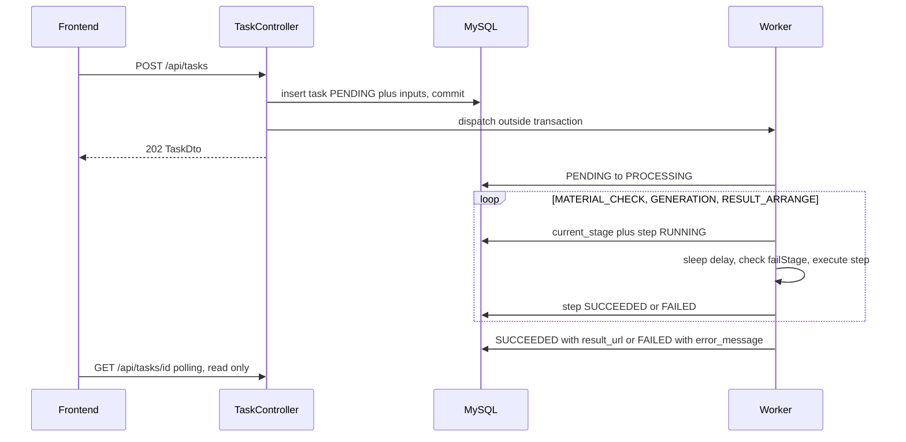

# 素材工坊：素材制作网站（全栈笔试题）

用户浏览模板、上传图片并提交制作任务；任务在 Java 后台按“素材检查 → 模拟生成 → 结果整理”三步异步执行，用户可继续使用网站，随时在个人记录中查看状态与结果。制作不调用真实 AI，由可控耗时与可控失败的模拟流水线完成业务闭环。

验收 commit：以 `main` 分支最新提交为准，提交笔试时会在沟通渠道中附上具体 commit hash。

## 目录

- [技术栈与版本](#技术栈与版本)
- [项目结构](#项目结构)
- [快速开始（Docker Compose）](#快速开始docker-compose)
- [本地开发](#本地开发)
- [构建与测试](#构建与测试)
- [配置项](#配置项)
- [数据库与初始化](#数据库与初始化)
- [模拟数据与素材](#模拟数据与素材)
- [主要接口](#主要接口)
- [任务状态、阶段与后台执行](#任务状态阶段与后台执行)
- [演示指南](#演示指南)
- [用户身份与个人记录](#用户身份与个人记录)
- [完成情况与已知限制](#完成情况与已知限制)
- [部署与回滚](#部署与回滚)
- [AI 使用说明](#ai-使用说明)
- [开源代码与素材复用](#开源代码与素材复用)
- [实际投入](#实际投入)

## 技术栈与版本

| 层 | 选型 |
| --- | --- |
| 前端 | Next.js 15.5.28（App Router，standalone 输出）、React 19.2.9、TypeScript 5.9、CSS Modules |
| 前端工具 | ESLint 9（flat config + eslint-config-next 15.5.28）、Vitest 3.2、Node.js 22 LTS（本地 ≥ 20.9 均可） |
| 后端 | Java 21、Spring Boot 3.5.16（web / validation / jdbc）、MyBatis Spring Boot Starter 3.0.5、Flyway（Boot 管理版本）、spring-security-crypto（仅 BCrypt） |
| 后端测试 | JUnit 5、Spring Boot Test、H2（MySQL 模式）、Awaitility |
| 数据库 | MySQL 8.0 |
| 构建 | Maven Wrapper（Maven 3.9.11）、npm（`package-lock.json`）、Docker Compose |

版本选择说明：Spring Boot 3.5 是 3.x 最新维护线，MyBatis starter 3.0.x 与之兼容（4.x 需要 Boot 4）；Next.js 15.5 与 React 19.2 兼容。

## 项目结构

```
.
├── .github/workflows/ci.yml        GitHub Actions：前端 lint/typecheck/test/build，后端 mvnw verify
├── docker-compose.yml              MySQL + 后端 + 前端
├── .env.example                    可覆盖的配置示例（非真实凭据）
├── backend/                        Spring Boot 后端
│   ├── src/main/java/com/example/studio/
│   │   ├── auth/                   注册/登录/会话、AuthInterceptor、@CurrentUserId
│   │   ├── template/               模板查询
│   │   ├── upload/                 上传校验（魔数识别）、本地存储、文件访问
│   │   ├── task/                   任务受理、TaskPipeline、TaskStateService、steps/、TaskRecoveryRunner
│   │   ├── simulation/             模拟配置与开发接口
│   │   ├── common/ config/         错误码、异常处理、线程池、Web 配置
│   ├── src/main/resources/
│   │   ├── db/migration/           Flyway：V1 建表、V2 种子数据
│   │   └── assets/                 自绘 SVG：covers/ 模板封面、results/ 模拟结果
│   ├── src/test/                   集成测试（H2）
│   └── tools/generate-assets.mjs   重新生成 SVG 素材的脚本
└── frontend/                       Next.js 前端
    └── src/
        ├── app/                    路由：/、/templates/[id]、/history、/login
        ├── components/             layout/ templates/ upload/ tasks/ auth/ ui/
        └── lib/                    api/（请求封装与类型）、auth/、tasks/（TaskTracker、useTaskFeed）
```

## 快速开始（Docker Compose）

前提：Docker（含 Compose v2）。

```bash
docker compose up --build
```

- 打开 <http://localhost:3000>
- 演示账号：`demo1@example.com` / `demo2@example.com`，密码均为 `Demo@123456`（也可以自行注册）
- 后端也直接暴露在 <http://localhost:8080>，MySQL 映射到宿主机 `3307` 端口

首次启动时 MySQL 初始化较慢，后端可能因连接失败重启一两次（`restart: on-failure`），属预期现象。清空全部数据：`docker compose down -v`。

不需要 `.env` 文件即可启动；如需覆盖默认值，复制 `.env.example` 为 `.env` 再修改。

## 本地开发

```bash
# 1. 只启动数据库（宿主机端口 3307）
docker compose up -d mysql

# 2. 后端（需要 JDK 21）：默认连接 localhost:3307，文件存储在 backend/data/storage
cd backend
./mvnw spring-boot:run            # Windows: mvnw.cmd spring-boot:run
# 如需开发接口：./mvnw spring-boot:run -Dspring-boot.run.arguments=--app.dev-api.enabled=true

# 3. 前端（Node 22）
cd frontend
npm ci
npm run dev                        # http://localhost:3000
```

**前后端与数据库如何连接**

- 浏览器只访问 Next.js（:3000）。`next.config.ts` 用 `rewrites` 把 `/api/*` 转发到 `BACKEND_URL`（默认 `http://localhost:8080`），因此前后端同源，登录 Cookie 直接可用，无需 CORS。
- Next.js 只负责页面与转发；所有业务逻辑与持久化在 Java 后端。
- 注意：standalone 构建会在**构建时**固化 rewrites，修改 `BACKEND_URL` 需要重新构建前端镜像（Compose 中通过 build arg 传入 `http://backend:8080`）。
- 后端通过 `SPRING_DATASOURCE_*` 连接 MySQL，启动时由 Flyway 自动建表并写入种子数据。

## 构建与测试

| 目的 | 命令 |
| --- | --- |
| 前端 lint | `cd frontend && npm run lint` |
| 前端类型检查 | `npm run typecheck`（先 `next typegen` 生成路由与 CSS Module 类型，再 `tsc --noEmit`） |
| 前端单元测试 | `npm test` |
| 前端构建 | `npm run build` |
| 后端测试 + 打包 | `cd backend && ./mvnw -B verify` |

本机没有 JDK 时，可在容器中运行后端测试：

```bash
docker run --rm -v "$PWD/backend:/app" -v studio-m2:/root/.m2 -w /app eclipse-temurin:21-jdk sh mvnw -B verify
```

CI（`.github/workflows/ci.yml`）在每次 push 与 pull request 时执行上述全部检查。

### 测试覆盖的核心行为

后端（30 个用例，H2 MySQL 模式）：

- `TaskPipelineTest`：三步按顺序执行且各自落库；分别在三个阶段注入失败时任务 FAILED、`currentStage` 为失败阶段、后续步骤不执行；素材文件被删除时素材检查失败；同一任务重复 `run` 不会重复执行；终态多次查询不变。
- `TaskApiTest`：提交接口立即返回 202/PENDING 且不等待处理完成，随后可观察到 PROCESSING → SUCCEEDED；数量不符、重复/他人/其他模板的素材、模板不存在；用户间任务与结果文件隔离；分页与按模板过滤。
- `UploadApiTest`：按魔数识别真实类型（伪造扩展名被拒）、模板类型白名单、大小上限、空文件、文件仅本人可访问。
- `AuthApiTest`、`TaskRecoveryRunnerTest`、`DevSimulationApiTest`：注册登录登出、种子账号可登录、重启只清理启动前的任务、模拟配置快照进新任务。

前端（21 个用例，Vitest）：

- `taskTracker.test.ts`：多个任务互不串扰、终态后停止轮询；查询异常只改变同步状态而不把任务标记失败、连续失败后暂停并可手动恢复；404/401 处理；旧数据不覆盖终态；`dispose` 后丢弃迟到响应且无残留计时器。
- `client.test.ts`：HTTP 状态到错误类别的映射、超时归为网络错误、主动取消抛出 AbortError。

## 配置项

后端（`backend/src/main/resources/application.yml`，可用环境变量覆盖）：

| 配置 | 环境变量 | 默认值 | 说明 |
| --- | --- | --- | --- |
| `spring.datasource.url` | `SPRING_DATASOURCE_URL` | `jdbc:mysql://localhost:3307/studio?...&connectionTimeZone=UTC` | 数据库连接 |
| `spring.datasource.username/password` | `SPRING_DATASOURCE_USERNAME/PASSWORD` | `studio` / `studio_pass` | 演示用凭据 |
| `app.storage.root` | `APP_STORAGE_ROOT` | `./data/storage`（容器内 `/data/storage`） | 上传、中间产物、结果文件目录 |
| `app.auth.session-ttl` | `APP_AUTH_SESSION_TTL` | `7d` | 登录有效期 |
| `app.auth.cookie-secure` | `APP_AUTH_COOKIE_SECURE` | `false` | HTTPS 部署时设为 `true` |
| `app.task.worker-threads` | `APP_TASK_WORKER_THREADS` | `2` | 后台工作线程数，超出的任务排队 |
| `app.task.queue-capacity` | `APP_TASK_QUEUE_CAPACITY` | `100` | 等待队列容量 |
| `app.simulation.step-delay-ms` | `APP_SIMULATION_STEP_DELAY_MS` | `3000` | 每一步的模拟耗时（0~60000） |
| `app.simulation.fail-stage` | `APP_SIMULATION_FAIL_STAGE` | 空 | 启动即让指定阶段失败：`MATERIAL_CHECK` / `GENERATION` / `RESULT_ARRANGE` |
| `app.dev-api.enabled` | `APP_DEV_API_ENABLED` | `false`（Compose 中为 `true`） | 是否注册 `/api/dev/simulation` |
| `spring.servlet.multipart.max-file-size` | — | `10MB` | 全局上传上限（各模板另有更小上限） |

前端：`BACKEND_URL`（构建时生效，默认 `http://localhost:8080`）。

Compose：`MYSQL_PASSWORD`、`MYSQL_ROOT_PASSWORD`、`APP_SIMULATION_STEP_DELAY_MS`、`APP_TASK_WORKER_THREADS`，见 `.env.example`。所有默认值仅用于本地演示，不是真实凭据。

## 数据库与初始化

Flyway 在后端启动时自动执行：

- `V1__schema.sql`：建表（utf8mb4，时间统一以 UTC 存为 `DATETIME(3)`）
- `V2__seed.sql`：9 个模板 + 2 个演示账号（BCrypt 哈希）

| 表 | 说明 |
| --- | --- |
| `users` | 用户（邮箱唯一，小写存储） |
| `user_sessions` | 会话：只存 token 的 SHA-256，含过期时间 |
| `templates` | 模板：分类、封面、所需图片数、允许类型、大小上限、模拟结果素材 |
| `upload_assets` | 上传素材：所属用户与模板、识别出的类型、大小、存储路径 |
| `generation_tasks` | 任务：状态、当前阶段、失败原因、结果地址、创建时的模拟配置快照、各时间点 |
| `task_inputs` | 任务使用的素材及顺序 |
| `task_steps` | 每一步的执行记录（RUNNING/SUCCEEDED/FAILED、开始/结束时间、原因），即“独立可观察的执行边界” |

## 模拟数据与素材

- 模板数据在 `V2__seed.sql`，覆盖 4 个分类（创意图片、节日祝福、萌宠、写真婚礼）、所需图片 1/2/3 张、“仅 JPG/PNG”与“JPG/PNG/WEBP”两类类型限制、2 MB 与 5 MB 两档大小上限。
- 封面与模拟结果图是自绘 SVG（渐变 + 几何图形 + 文字），位于 `backend/src/main/resources/assets/`，由 `node backend/tools/generate-assets.mjs` 生成，无外部素材、无版权问题。后端通过 `/api/assets/**` 提供。
- 演示上传可以使用任意 JPG/PNG/WEBP 图片。

## 主要接口

所有接口前缀 `/api`。错误统一为 `{ "code": "...", "message": "中文原因" }`。

### 认证

| 方法 | 路径 | 请求 | 响应 |
| --- | --- | --- | --- |
| POST | `/auth/register` | `{ email, password(8~64), displayName? }` | 201 `UserDto`，并设置 `SESSION` Cookie |
| POST | `/auth/login` | `{ email, password }` | 200 `UserDto`，并设置 Cookie；错误 401 `INVALID_CREDENTIALS` |
| POST | `/auth/logout` | — | 204，清除 Cookie |
| GET | `/auth/me` | — | 200 `UserDto`；未登录 401 |

`UserDto = { id, email, displayName, createdAt }`

### 模板（公开）

| 方法 | 路径 | 响应 |
| --- | --- | --- |
| GET | `/templates/categories` | `string[]` |
| GET | `/templates?category=` | `TemplateDto[]` |
| GET | `/templates/{id}` | `TemplateDto`；不存在 404 `TEMPLATE_NOT_FOUND` |

`TemplateDto = { id, title, category, coverUrl, description, requiredImageCount, acceptedMimeTypes[], maxFileSizeBytes }`

### 上传与文件（需登录）

| 方法 | 路径 | 说明 |
| --- | --- | --- |
| POST | `/uploads` | multipart：`file`、`templateId` → 201 `{ id, url, mimeType, sizeBytes, originalName }` |
| GET | `/files/uploads/{uploadId}` | 仅上传者可访问 |
| GET | `/files/results/{taskId}` | 仅任务所有者、且任务已成功时可访问 |

上传校验顺序：模板存在 → 非空 → 不超过模板大小上限 → **按文件头魔数识别真实类型**并检查是否在模板白名单内（不信任客户端声明的 Content-Type）。文件响应带 `X-Content-Type-Options: nosniff` 与 `Content-Security-Policy: sandbox`。

### 任务（需登录）

| 方法 | 路径 | 说明 |
| --- | --- | --- |
| POST | `/tasks` | `{ templateId, uploadIds[] }` → **202** `TaskDto`（status 为 PENDING），不等待处理 |
| GET | `/tasks?templateId=&page=0&size=20` | `{ items: TaskDto[], hasMore }`，按创建时间倒序，size ≤ 50 |
| GET | `/tasks/{id}` | `TaskDto`；不存在或非本人 404 `TASK_NOT_FOUND` |

```jsonc
// TaskDto
{
  "id": "uuid",
  "templateId": "pet-sticker",
  "templateTitle": "萌宠贴纸",
  "status": "PENDING | PROCESSING | SUCCEEDED | FAILED",
  "currentStage": "MATERIAL_CHECK | GENERATION | RESULT_ARRANGE | null",
  "errorMessage": "失败原因或 null",
  "resultUrl": "/api/files/results/{id} 或 null",
  "steps": [{ "stage": "MATERIAL_CHECK", "status": "SUCCEEDED", "message": null, "startedAt": "...", "finishedAt": "..." }],
  "createdAt": "2026-11-02T13:00:00.123Z",
  "startedAt": "...",
  "finishedAt": "..."
}
```

### 开发接口（`app.dev-api.enabled=true` 时存在）

| 方法 | 路径 | 说明 |
| --- | --- | --- |
| GET | `/dev/simulation` | `{ failStage, stepDelayMs }` |
| PUT | `/dev/simulation` | `{ failStage: null 或阶段名, stepDelayMs: 0~60000 }`，只影响之后新建的任务 |

### 错误码

| HTTP | code |
| --- | --- |
| 400 | `VALIDATION_ERROR`、`FILE_EMPTY`、`FILE_TOO_LARGE`、`UNSUPPORTED_FILE_TYPE`、`IMAGE_COUNT_MISMATCH`、`INVALID_UPLOAD` |
| 401 | `UNAUTHORIZED`、`INVALID_CREDENTIALS` |
| 404 | `TEMPLATE_NOT_FOUND`、`TASK_NOT_FOUND`、`FILE_NOT_FOUND`、`NOT_FOUND` |
| 405 | `METHOD_NOT_ALLOWED` |
| 409 | `EMAIL_EXISTS` |
| 413 | `PAYLOAD_TOO_LARGE`（超过全局 10 MB） |
| 500 | `INTERNAL_ERROR` |

## 任务状态、阶段与后台执行

- **整体状态** `status`：`PENDING`（已受理、排队等待）→ `PROCESSING` → `SUCCEEDED` / `FAILED`。终态不可逆：所有状态更新都带 `WHERE status = ...` 条件。
- **当前阶段** `currentStage`：`MATERIAL_CHECK`（素材检查）→ `GENERATION`（模拟生成）→ `RESULT_ARRANGE`（结果整理）。失败时保留失败所在阶段。
- **每一步的记录** `steps`：来自 `task_steps` 表，每一步开始时写入 RUNNING，结束时更新为 SUCCEEDED 或 FAILED。



执行方式：

1. `TaskController` 先调用 `TaskService.create`（事务内校验并写入 PENDING 任务及素材关联，方法返回时已提交），再在事务外调用 `TaskDispatcher.dispatch` 把任务交给 `ThreadPoolTaskExecutor`（默认 2 个线程、队列 100）。队列满时任务直接标记失败。
2. `TaskPipeline.run` 先用条件更新 `PENDING → PROCESSING`（重复执行时影响行数为 0 直接返回），再依次执行三步：
   - **素材检查**：确认每个输入文件仍存在，大小与魔数类型与上传记录一致；
   - **模拟生成**：把模板预置的结果图复制到 `work/{taskId}/`；
   - **结果整理**：移动到 `results/{taskId}.svg`、清理工作目录，生成可预览地址。
   每一步前 `sleep(模拟耗时)`，若该阶段是注入的失败阶段则抛出模拟失败。任一步失败立即把该步与任务标记为 FAILED 并停止，后续步骤不执行。
3. 所有状态写入集中在 `TaskStateService`（独立 bean，保证 `@Transactional` 经过代理生效），每次写入都是短事务，不在事务中 sleep。
4. 查询接口只读，不会推进任务状态。
5. 模拟配置（失败阶段、耗时）在创建任务时快照进任务行，之后修改配置不影响已创建的任务。
6. 服务重启：`TaskRecoveryRunner` 启动时把**启动前创建**的 PENDING/PROCESSING 任务标记为 FAILED（“服务重启，任务已中断”），不做断点续跑。

## 演示指南

以下默认通过 Compose 启动，前端 <http://localhost:3000>。

### 1. 成功路径

登录 `demo1@example.com` → 选择模板（如“萌宠贴纸”）→ 上传图片 → 点击“立即制作”。按钮立即恢复，右侧“制作记录”出现新任务：等待处理 → 素材检查中 → 模拟生成中 → 结果整理中 → 已完成（显示结果图，点击可放大）。默认每步 3 秒。

### 2. 指定阶段失败、调整耗时

开发接口经前端同源转发，也可直接访问后端 8080 端口。

PowerShell：

```powershell
# 让“模拟生成”阶段失败，并把每步耗时调为 5 秒
Invoke-RestMethod -Method Put -Uri http://localhost:3000/api/dev/simulation `
  -ContentType 'application/json' -Body '{"failStage":"GENERATION","stepDelayMs":5000}'

# 恢复默认
Invoke-RestMethod -Method Put -Uri http://localhost:3000/api/dev/simulation `
  -ContentType 'application/json' -Body '{"failStage":null,"stepDelayMs":3000}'
```

bash：

```bash
curl -X PUT http://localhost:3000/api/dev/simulation \
  -H 'Content-Type: application/json' -d '{"failStage":"GENERATION","stepDelayMs":5000}'

curl -X PUT http://localhost:3000/api/dev/simulation \
  -H 'Content-Type: application/json' -d '{"failStage":null,"stepDelayMs":3000}'
```

`failStage` 可选 `MATERIAL_CHECK` / `GENERATION` / `RESULT_ARRANGE`，配置一直生效，可重复触发。之后新建的任务会在该阶段失败，卡片显示失败阶段与原因，后续阶段显示“未执行”。也可以在启动前设置环境变量 `APP_SIMULATION_FAIL_STAGE` 与 `APP_SIMULATION_STEP_DELAY_MS`。

### 3. 用命令行调用业务接口

```bash
# 登录并保存 Cookie
curl -c cookie.txt -H 'Content-Type: application/json' \
  -d '{"email":"demo1@example.com","password":"Demo@123456"}' http://localhost:3000/api/auth/login
# 上传 → 提交 → 查询
curl -b cookie.txt -F templateId=pet-sticker -F file=@photo.jpg http://localhost:3000/api/uploads
curl -b cookie.txt -H 'Content-Type: application/json' \
  -d '{"templateId":"pet-sticker","uploadIds":["<上一步返回的 id>"]}' http://localhost:3000/api/tasks
curl -b cookie.txt http://localhost:3000/api/tasks/<taskId>
```

PowerShell 可用 `Invoke-RestMethod ... -SessionVariable s` 登录，之后的请求加 `-WebSession $s`。

### 4. 多任务与排队

上传好图片后连续点击“立即制作” 3 次。默认 2 个工作线程，前两个任务进入处理中，第三个显示“等待处理”，前面的任务完成后才开始。各任务的阶段、结果、失败原因互不影响。可以把耗时调大（如 8000ms）便于观察。

### 5. 刷新恢复与离开页面

任务处理中刷新页面或关闭标签页：后台继续执行；重新打开后从 Java 后端加载记录，并自动继续跟踪未完成的任务。“我的记录”页面汇总所有模板的任务。

### 6. 用户隔离

分别用 `demo1` 与 `demo2` 登录（右上角头像 → 账户设置 → 退出登录），两者只能看到各自的记录；直接访问他人的任务或结果地址返回 404。

### 7. 查询异常与任务失败的区分

任务处理中打开浏览器 DevTools → Network → 选择 Offline：卡片出现黄色“状态同步失败，正在重试…”，任务状态保持原样（不会变成失败）；连续失败 3 次后停止自动重试，显示“重新查询”按钮。切回 Online 后点击“重新查询”，即可看到后端的真实结果（任务在后台一直在执行）。

另一个边界：处理中执行 `docker compose restart backend`，重启后这些任务会显示“服务重启，任务已中断”。这是有意的简化设计，见下文。

## 用户身份与个人记录

- **身份**：邮箱 + 密码注册/登录。密码用 BCrypt 存储；登录后服务端生成 32 字节随机 token，数据库只存 SHA-256，通过 `SESSION` Cookie（`HttpOnly; SameSite=Lax; Path=/`，HTTPS 下可开启 `Secure`）传递，有效期 7 天，过期会话在使用时清理。
- **为什么用 Cookie 而不是 Bearer**：结果图与上传图通过 `` 加载，只有 Cookie 能让这些请求也带上身份并做归属校验。前后端同源（Next.js rewrites），`SameSite=Lax` 加上只接收 JSON/multipart 的接口，可以挡住跨站提交，因此未额外实现 CSRF token。
- **个人记录**：上传素材、任务、结果文件都绑定 `user_id`；所有查询都带当前用户条件，他人资源一律返回 404（不暴露是否存在）。
- **前端**：`AuthProvider` 启动时调用 `/api/auth/me` 区分已登录、未登录与“服务器不可达”（后者不会把用户踢到登录页）。任务跟踪器按“用户 + 页面”创建，切换或退出用户时销毁，停止全部轮询并丢弃迟到的响应。
- **演示**：使用两个预置账号，或在 `/login` 切换到“注册”自行创建。

## 完成情况与已知限制

已完成：

- 模板列表与分类筛选（分类保存在 URL 中）、模板详情、按模板要求渲染上传位，支持选择、预览、替换、移除，上传中与上传失败反馈，前后端双重校验数量、类型与大小。
- 提交立即返回 202，多步骤后台执行与逐步落库，指定阶段失败与耗时可调，失败中断后续步骤。
- 前端区分上传中、提交中、等待处理、处理中、成功、失败，以及“查询异常”（与任务失败分开展示，可手动恢复）；多任务独立轮询，终态停止，离开页面或切换用户时清理。
- 个人记录页（分页“加载更多”）、刷新恢复、结果图预览、账户设置对话框（参考截图）。
- 加载中、空数据、请求失败、模板不存在等界面反馈；键盘焦点样式与上传、图标按钮的可读标签；窄屏下单列可操作。
- CI、后端与前端测试、Docker Compose 一键启动。

未完成、已知限制与取舍：

- **服务重启不续跑**：重启时把未完成任务标记为“服务重启，任务已中断”。只按“启动前创建”过滤，假设**单实例**部署；多实例需要改为租约或心跳。
- **不支持重新执行失败任务**、下载、删除记录（题目不要求）。
- **孤儿上传文件不清理**：上传后未用于任务、或在前端移除的文件仍保留在存储中。
- **任务受理无幂等键**：前端在提交中禁用按钮防止重复点击；网络超时后重试可能产生重复任务。
- **无登录限流、无密码重置**。
- **开发接口是全局配置且无鉴权**，只应在演示或测试环境开启（默认关闭，Compose 中开启）。
- **多个标签页之间的登录状态不同步**：在一个标签页退出后，另一个标签页要等到下一次请求返回 401 才切换为未登录。
- **测试使用 H2（MySQL 模式）**：SQL 保持在两者兼容的子集内，真实 MySQL 通过 Compose 运行验证；两者在极端情况下可能存在差异。
- **轮询而非推送**：每个未完成任务每 1.5 秒查询一次，任务很多时请求数随之增加；可改为批量查询或 SSE。
- **结果图**：按题目要求不做真实图片处理，结果为模板预置的 SVG。

## 部署与回滚

部署（单机示例）：

1. 构建并打标签：`docker compose build`，再 `docker tag` 为带版本号的镜像（例如 `studio-backend:1.0.1`、`studio-frontend:1.0.1`）并推送到镜像仓库。
2. 生产环境的 Compose 中引用固定 tag 的镜像，设置真实的数据库密码、`APP_AUTH_COOKIE_SECURE=true`、`APP_DEV_API_ENABLED=false`，在前面放 HTTPS 反向代理。
3. `docker compose pull && docker compose up -d`；Flyway 在后端启动时自动执行新的迁移。

回滚：

1. 把 Compose 中的镜像 tag 改回上一个版本，`docker compose up -d`。
2. Flyway 迁移只向前执行。回滚前确认旧版本能兼容新 schema（本项目的迁移保持向后兼容的“只增不改”原则）；不兼容时需要先准备反向 SQL 并备份数据库。
3. 数据卷 `mysql-data`、`storage-data` 在回滚时保持不变。

## AI 使用说明

本项目使用 Cursor（AI 编程助手）完成，工作流如下：

1. **拆解**：先让 AI 逐条阅读题目要求（R-01 ~ R-14），确认身份方案（邮箱+密码）与界面语言，再产出一份详细的实施计划（数据表、接口、状态机、前端跟踪器规则、测试清单、交付物）。
2. **评审计划**：在写代码前对计划做了多轮评审，专门找“实现时会出错”的点并修正。
3. **生成与修改**：按计划分模块生成代码：后端（认证 → 模板/上传 → 任务流水线）→ 前端（请求封装 → 跟踪器 → 页面）→ 交付物。
4. **验证**：后端测试在容器中运行（本机无 JDK），前端执行 lint、类型检查、单元测试与构建，最后用 Compose 启动做端到端检查。

一个具体的例子（评审阶段发现并修正）：

- 初版计划在事务提交回调 `TransactionSynchronization.afterCommit` 中把任务交给线程池，并在队列满时把任务标记为失败。评审时发现，Spring 的 afterCommit 回调中访问数据库仍会挂靠在原事务资源上，这次写入可能不会被提交（需要 `REQUIRES_NEW`）。修正为：控制器先调用带事务的 `create` 并返回，再在事务外 `dispatch`。
- 同一轮评审还发现 `TaskRecoveryRunner` 在 Web 服务已启动后才执行，会误伤启动过程中新提交的任务；修正为只处理 `created_at < bootTime` 的任务，并用 `TaskRecoveryRunnerTest` 验证“启动前的任务被标记失败、启动后的任务保持不变”。

实现阶段的问题与修正：

- 第一次安装前端依赖时网络中断，生成的 `package-lock.json` 缺少 `resolved/integrity` 字段，导致 Next 的 SWC 原生包没有安装、`next typegen` 卡住；排查后删除锁文件重新安装，并用前端 Docker 镜像中的 `npm ci` 验证锁文件在 Linux 下可用。
- 一个前端测试复用了同一个 `Response` 对象导致读取两次报错，修正的是测试本身。
- 浏览器端到端检查时发现模板卡片上标题重复（SVG 封面里画了标题，卡片又叠加了一次），改为封面不画标题、只在结果图上画。
- ESLint 提示 effect 清理函数中读取了会变化的 ref，改为用跟踪器自身的 `isDisposed()` 判断列表响应是否过期，逻辑更直接。

## 开源代码与素材复用

- 未复制第三方项目代码；使用的框架与库均通过包管理器引入（见 `pom.xml`、`package.json`）。
- 项目脚手架为手写配置（未使用 create-next-app 模板）。Maven Wrapper 由官方 `maven-wrapper-plugin` 生成。
- 所有图片素材均为 `backend/tools/generate-assets.mjs` 生成的自绘 SVG。

## 实际投入

> 待填写：实际投入时间（开发、验证、交付整理），以及主要取舍。
